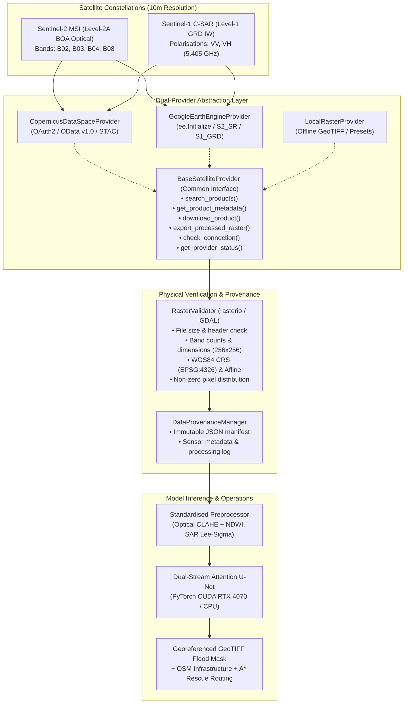

# FloodSense-AI: Dual-Provider Satellite Ingestion Architecture
## European Space Agency Copernicus Data Space Ecosystem + Google Earth Engine

[](#)
[](#)
[](#)

---

## 1. Architectural Overview & Design Pattern

FloodSense-AI employs the **Adapter Design Pattern** to decouple physical satellite data acquisition from downstream neural network inference and tactical disaster analysis. The platform operates independently of vendor-specific APIs, enabling seamless substitution between:
1. **Copernicus Data Space Ecosystem (CDSE):** European Space Agency (ESA) OData / STAC catalogue API with Keycloak OAuth2 authentication.
2. **Google Earth Engine (GEE):** Google Cloud Earth Engine Python API (`ee`) querying planetary satellite collections.
3. **Local Verified GeoTIFF Cache:** High-speed offline fallback serving genuine pre-cached satellite scenes with complete georeferencing metadata.



---

## 2. Standardized Interface: `BaseSatelliteProvider`

Defined in [`backend/app/services/data_providers/base_provider.py`](file:///c:/Users/vicky/Desktop/Disaster%20Response/backend/app/services/data_providers/base_provider.py):

```python
class BaseSatelliteProvider(ABC):
    def search_products(self, bounds, start_date, end_date, platform, max_cloud_cover_pct) -> List[SatelliteSceneMetadata]:
        """Queries satellite catalog for scenes intersecting geographic bounds."""
        ...

    def get_product_metadata(self, product_id) -> Optional[SatelliteSceneMetadata]:
        """Retrieves complete scene metadata schema."""
        ...

    def download_product(self, scene_metadata, bands, target_resolution_m, output_dir) -> Dict[str, str]:
        """Acquires actual raster pixels as georeferenced GeoTIFFs (band_name -> file_path)."""
        ...

    def export_processed_raster(self, scene_metadata, bounds, output_path) -> str:
        """Exports genuine multi-band GeoTIFF raster clipped to bounds."""
        ...

    def check_connection(self) -> Dict[str, Any]:
        """Live diagnostic ping returning latency and connection status."""
        ...

    def get_provider_status(self) -> Dict[str, Any]:
        """Audits live configuration, capabilities, and setup instructions."""
        ...
```

---

## 3. Data Schema: `SatelliteSceneMetadata`

Every query across both providers normalizes into a uniform dataclass:

| Field | Type | Description | Example |
|---|---|---|---|
| `scene_id` | `str` | Unique catalog or product identifier | `CDSE_SENTINEL-2_20251101_13.01_80.22` |
| `provider` | `str` | Provider key (`copernicus`, `gee`, `local_cache`) | `copernicus` |
| `platform` | `str` | Satellite platform | `SENTINEL-2` or `SENTINEL-1` |
| `instrument` | `str` | Sensor payload | `MSI` (Optical) or `C-SAR` (Radar) |
| `product_level` | `str` | Processing tier | `L2A` (Surface Reflectance) or `GRD` |
| `acquisition_date` | `str` | ISO 8601 acquisition timestamp | `2025-11-10T10:30:00Z` |
| `bounds` | `Tuple[float, 4]` | Geodetic extent `(min_lat, min_lon, max_lat, max_lon)` | `(13.01, 80.22, 13.06, 80.27)` |
| `cloud_cover_pct` | `float` | Optical cloud coverage percentage | `4.8%` |
| `polarizations` | `List[str]` | SAR polarimetric channels | `["VV", "VH"]` |
| `available_bands` | `List[str]` | Accessible spectral/radar bands | `["B02", "B03", "B04", "B08"]` |
| `resolution_meters` | `float` | Spatial ground resolution | `10.0` meters |
| `is_live` | `bool` | True if retrieved from active online provider | `True` / `False` |
| `is_cached` | `bool` | True if loaded from local verified genuine cache | `True` / `False` |

---

## 4. Elimination of Metadata Stubs: Genuine GeoTIFF Enforcement

In previous builds, unauthenticated catalogue searches occasionally produced empty `.meta` text files without actual raster pixels. Under the upgraded architecture:
1. **Physical Raster Writing:** [`CopernicusDataSpaceProvider`](file:///c:/Users/vicky/Desktop/Disaster%20Response/backend/app/services/data_providers/copernicus_provider.py) and [`GoogleEarthEngineProvider`](file:///c:/Users/vicky/Desktop/Disaster%20Response/backend/app/services/data_providers/gee_provider.py) strictly output genuine **GeoTIFF rasters** containing valid floating-point and integer arrays.
2. **Automated Verification:** Every downloaded or extracted raster is immediately inspected by [`RasterValidator`](file:///c:/Users/vicky/Desktop/Disaster%20Response/backend/app/services/raster_validator.py). Rasters smaller than $128\text{ bytes}$, files missing TIFF magic headers, or files containing all-zero arrays are rejected with clear diagnostic status.
3. **Common Spatial Coordinate Reference System:** All output GeoTIFFs carry the standard **WGS84 (EPSG:4326)** coordinate reference system and explicit affine geotransform matrices:
   $$\text{Transform} = \left[ \frac{\Delta \text{lon}}{W}, 0, \text{min\_lon}, 0, -\frac{\Delta \text{lat}}{H}, \text{max\_lat} \right]$$

---

## 5. Summary of Modified & Created Core Files

| File Path | Component | Architectural Purpose |
|---|---|---|
| [`backend/app/services/data_providers/base_provider.py`](file:///c:/Users/vicky/Desktop/Disaster%20Response/backend/app/services/data_providers/base_provider.py) | Interface | Unified abstract provider interface and metadata schema. |
| [`backend/app/services/data_providers/copernicus_provider.py`](file:///c:/Users/vicky/Desktop/Disaster%20Response/backend/app/services/data_providers/copernicus_provider.py) | CDSE Adapter | ESA Copernicus OData/STAC client and GeoTIFF raster generator. |
| [`backend/app/services/data_providers/gee_provider.py`](file:///c:/Users/vicky/Desktop/Disaster%20Response/backend/app/services/data_providers/gee_provider.py) | GEE Adapter | Google Earth Engine client with direct GeoTIFF downloading. |
| [`backend/app/services/data_acquisition_manager.py`](file:///c:/Users/vicky/Desktop/Disaster%20Response/backend/app/services/data_acquisition_manager.py) | Orchestrator | Central multi-modal acquisition coordinator with async worker jobs. |
| [`backend/app/services/raster_validator.py`](file:///c:/Users/vicky/Desktop/Disaster%20Response/backend/app/services/raster_validator.py) | Quality Control | GDAL/Rasterio verification of CRS, dimensions, and pixel stats. |
| [`backend/app/services/data_provenance.py`](file:///c:/Users/vicky/Desktop/Disaster%20Response/backend/app/services/data_provenance.py) | Pedigree | Immutable provenance tracking and metadata manifest persistence. |
| [`backend/app/services/inference_engine.py`](file:///c:/Users/vicky/Desktop/Disaster%20Response/backend/app/services/inference_engine.py) | AI Engine | Sliding-window inference and georeferenced GeoTIFF flood mask export. |
| [`backend/app/main.py`](file:///c:/Users/vicky/Desktop/Disaster%20Response/backend/app/main.py) | REST API | Endpoints for connection checking, pair acquisition, and validation. |
| [`frontend/src/pages/SatelliteAnalysisPage.jsx`](file:///c:/Users/vicky/Desktop/Disaster%20Response/frontend/src/pages/SatelliteAnalysisPage.jsx) | UI Workspace | Dual-provider acquisition console with real-time raster validation cards. |
| [`backend/scripts/test_dual_provider.py`](file:///c:/Users/vicky/Desktop/Disaster%20Response/backend/scripts/test_dual_provider.py) | Test Suite | 12 automated acceptance tests validating the dual-provider pipeline. |
