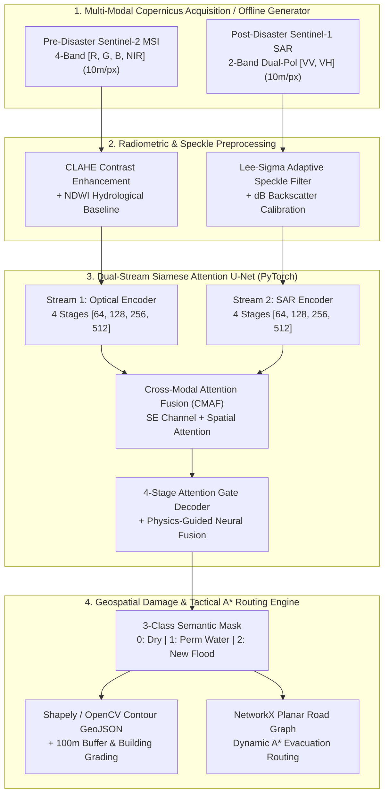
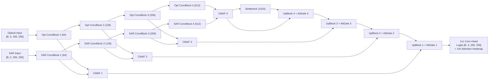

# FloodSense-AI: Multi-Modal SAR & Optical Change Detection, Damage Mapping, and Rescue Routing System for Disaster Response

[](#)
[](#)
[](#)
[](#)

> **B.E. Final Year Capstone Project** — An end-to-end geospatial deep learning and tactical decision-support platform that fuses **Pre-Disaster Sentinel-2 Multi-Spectral Optical** imagery with **Post-Disaster Sentinel-1 C-Band Synthetic Aperture Radar (SAR)** imagery to delineate active flood inundation through heavy monsoon cloud cover, grade building footprint submergence, and compute real-time **A\* evacuation corridors** around severed road networks.

---

## 1. Abstract & Problem Statement

### Why Single-Sensor Optical Satellite Systems Fail During Cyclonic Floods
During severe cyclonic and monsoon flood disasters (such as the Chennai Adyar Basin surge, Assam Brahmaputra inundation, or Kerala Western Ghats flash floods), persistent **opaque cloud cover (80%–100%)** and atmospheric aerosols completely obstruct optical spaceborne sensors (Sentinel-2 MSI, Landsat-8/9). Waiting days for cloud-free skies renders optical-only change detection ineffective during the critical first **72 hours of emergency rescue operations**.

### How Multi-Modal SAR + Optical Fusion Solves the Problem
1. **All-Weather C-Band Radar Penetration (Sentinel-1 SAR):** Operating at $5.405\text{ GHz}$ ($\lambda \approx 5.55\text{ cm}$), C-band SAR penetrates thick monsoon clouds, rain cells, and smoke day and night. Calm floodwater acts as a **specular reflector**, bouncing microwave pulses away from the sensor and producing a sharp backscatter drop ($\sigma^0_{\text{VV}} < -16\text{ dB}$).
2. **Pre-Event Optical Baseline Context (Sentinel-2 MSI):** Pre-disaster 4-band Optical imagery (`Red`, `Green`, `Blue`, `NIR`) provides high-contrast land-use context, urban building footprints, road networks, and permanent water body baselines via the **Normalized Difference Water Index (NDWI)**.
3. **Dual-Stream Siamese Attention U-Net with Cross-Modal Attention Fusion (CMAF):** By encoding Pre-Flood Optical and Post-Flood SAR in parallel streams and fusing them with **Squeeze-and-Excitation Channel Attention** + **Spatial Attention Gates**, the network suppresses SAR multiplicative speckle noise and optical cloud shadows while isolating **Class 1 (Permanent Water)** from **Class 2 (New Flood Inundation)**.

---

## 2. System Architecture & Deep Learning Pipeline

### 2.1 End-to-End Geospatial Architecture



### 2.2 Dual-Stream Siamese Attention U-Net Block Diagram



---

## 3. Mathematical Formulation

### 3.1 Normalized Difference Water Index (NDWI)
Computed from Pre-Event Sentinel-2 Green ($B_3$) and Near-Infrared ($B_8$) surface reflectance bands to establish baseline permanent water bodies:

$$\text{NDWI} = \frac{\rho_{\text{Green}} - \rho_{\text{NIR}}}{\rho_{\text{Green}} + \rho_{\text{NIR}} + 10^{-6}}$$

### 3.2 Lee-Sigma Adaptive SAR Speckle Filter
Suppresses multiplicative radar granular noise over homogeneous water and terrain while preserving high-gradient shoreline edges:

$$\hat{I}(x,y) = \bar{I}(x,y) + W(x,y)\,\left(I(x,y) - \bar{I}(x,y)\right), \quad W(x,y) = \frac{\sigma_x^2}{\sigma_x^2 + \sigma_v^2 \, \bar{I}^2}$$

where $\bar{I}$ and $\sigma_x^2$ are the local sliding-window mean and variance, and $\sigma_v^2 = 1 / L$ is the equivalent number of looks ($L$) noise variance.

### 3.3 Additive Soft Attention Gate (Decoder Skip Connections)
Given gating signal $g \in \mathbb{R}^{F_g \times H \times W}$ from the coarser decoder scale and fused skip feature $x^l \in \mathbb{R}^{F_l \times H \times W}$ from the CMAF module:

$$q_{\text{att}}^l = \psi^T \left( \text{ReLU}\left( W_x^T x^l + W_g^T g + b_g \right) \right) + b_\psi, \quad \alpha^l = \sigma\left(q_{\text{att}}^l\right), \quad \hat{x}^l = \alpha^l \odot x^l$$

### 3.4 Combined Focal + Multiclass Dice Objective Function
To handle class imbalance between dry background pixels and active flood boundaries:

$$\mathcal{L}_{\text{Focal}} = -\frac{1}{N}\sum_{i=1}^{N} \alpha_{y_i} \left(1 - p_{i, y_i}\right)^\gamma \log\left(p_{i, y_i}\right)$$

$$\mathcal{L}_{\text{Dice}} = 1 - \frac{1}{C}\sum_{c=0}^{C-1} \frac{2 \sum_{i} p_{i,c}\,g_{i,c} + \epsilon}{\sum_{i} p_{i,c}^2 + \sum_{i} g_{i,c}^2 + \epsilon}$$

$$\mathcal{L}_{\text{Total}} = 0.5\,\mathcal{L}_{\text{Focal}} + 0.5\,\mathcal{L}_{\text{Dice}}$$

### 3.5 Spatial Telemetry & Dynamic A\* Rescue Routing Heuristic
At Sentinel $10\text{m} \times 10\text{m}$ spatial resolution ($1\text{ pixel} = 100\text{ m}^2 = 0.0001\text{ km}^2$):

$$\text{Area}_{\text{flood}} (\text{km}^2) = N_{\text{class 2}} \times 0.0001, \quad \text{Expansion (\%)} = \frac{\text{Area}_{\text{flood}}}{\max(\text{Area}_{\text{perm}}, 0.01)} \times 100$$

For any road edge $e = (u, v)$ in the planar graph $G=(V, E)$, let $r_{\text{flood}}(e) \in [0, 1]$ denote the fraction of sampled points intersecting Class 1 or Class 2 water:

$$w(e) = \begin{cases} \infty \text{ (BLOCKED)} & \text{if } r_{\text{flood}}(e) > 0.12 \\ d_{\text{Haversine}}(u, v) \cdot \left(1 + 1.8\,r_{\text{buffer}}(e)\right) & \text{otherwise} \end{cases}$$

The A\* search minimizes $f(n) = g(n) + h(n)$ where $h(n) = d_{\text{Haversine}}(n, \text{target})$.

---

## 4. Repository Structure

```text
floodsense-ai/
├── README.md
├── backend/
│   ├── requirements.txt
│   ├── run.py
│   ├── scripts/
│   │   ├── init_demo_data.py          # Generates demo satellite tiles, presets & model checkpoint
│   │   └── train_sen1floods11.py      # Full academic training pipeline (Focal+Dice Loss, mIoU, F1)
│   └── app/
│       ├── __init__.py
│       ├── main.py                    # FastAPI app, CORS, endpoints (/api/health, /api/presets, /api/analyze, /api/gee-fetch)
│       ├── config.py                  # Paths, constants, GEE config, spatial resolution (10m/pixel)
│       ├── models/
│       │   ├── __init__.py
│       │   ├── attention_unet.py      # Dual-Stream Siamese Attention U-Net + Cross-Modal Attention Fusion
│       │   └── losses.py              # Combined Focal Loss + Multiclass Dice Loss
│       └── services/
│           ├── __init__.py
│           ├── preprocessor.py        # Lee-Sigma SAR speckle filter, CLAHE, NDWI computation, tensor prep
│           ├── inference_engine.py    # PyTorch forward pass + Grad-CAM/Attention Heatmap + Hybrid Physics-AI fusion
│           ├── damage_analyzer.py     # Pixel-to-km2 math, building footprint damage grading, GeoJSON contour extraction
│           ├── rescue_router.py       # NetworkX graph builder + A* dynamic evacuation routing around flood polygons
│           └── gee_connector.py       # Google Earth Engine live fetcher with automatic offline synthetic fallback
└── frontend/
    ├── package.json
    ├── vite.config.js
    ├── tailwind.config.js
    ├── postcss.config.js
    ├── index.html
    └── src/
        ├── main.jsx
        ├── App.jsx                    # Main Tactical Disaster Command Center layout
        ├── index.css                  # Tailwind imports + custom dark GIS scrollbars & radar pulse animations
        ├── services/
        │   └── api.js                 # Axios/Fetch client for FastAPI backend
        └── components/
            ├── HeaderBar.jsx          # Sensor telemetry status, GPU/CPU badge, PDF/GeoJSON Mission Export
            ├── ControlSidebar.jsx     # Preset case selector, Custom Upload, GEE Coordinate input, Layer Toggles
            ├── MapViewport.jsx        # Leaflet GIS map with GeoJSON flood polygons, buildings & A* rescue routes
            ├── SplitCompareSlider.jsx # Interactive Before (Optical) vs. After (SAR + Flood Mask) curtain slider
            └── AnalyticsDock.jsx      # 4 KPI cards + Recharts (Flood Expansion Bar Chart, SAR Backscatter Curve, Model Metrics)
```

---

## 5. Local Setup & Execution Guide

### Step 1: Launch the FastAPI Geospatial & PyTorch Backend (`Port 8000`)

Open a terminal in the project root and run:

```bash
cd backend
pip install -r requirements.txt
python run.py
```

*Note:* On first startup, `run.py` automatically invokes `scripts/init_demo_data.py` to synthesize the 3 disaster case study tiles (`chennai_monsoon_2026`, `assam_brahmaputra_surge`, `wayanad_kerala_flashflood`), building footprint databases, and calibrated `DualStreamAttentionUNet` weights in `backend/data/`.

### Step 2: Launch the React Tactical Command Center (`Port 5173`)

Open a second terminal in the project root and run:

```bash
cd frontend
npm install
npm run dev
```

Open **`http://localhost:5173`** in your browser.

### Step 3: Run Academic Model Training on Sen1Floods11 (Optional for Viva Demonstration)

To demonstrate the multi-epoch training loop with `CombinedFloodLoss` (`0.5 * FocalLoss + 0.5 * DiceLoss`), `CosineAnnealingLR`, and epoch-wise `mIoU`, `F1-Score`, `Precision`, and `Recall` logging:

```bash
cd backend
python scripts/train_sen1floods11.py --epochs 10 --batch_size 4 --lr 0.0008
```

