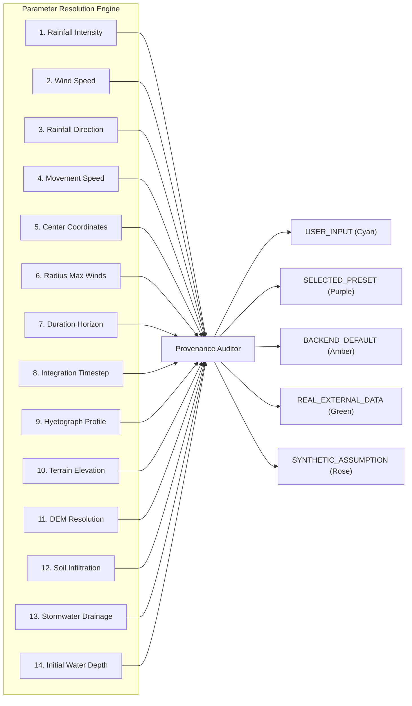

# FloodSense-AI: Cyclone Simulation Input & Output Transparency Audit

**Document Reference:** `SCENARIO_INPUT_AUDIT.md`  
**Audit Date:** November 2026  
**System Version:** FloodSense-AI v2.4 (Geospatial Multi-Modal Disaster Intelligence)  
**Audit Objective:** Investigate parameter propagation, eliminate silent default substitutions, provide 100% parameter provenance, and ensure physical consistency across the simulation, damage assessment, and rescue routing pipelines.

---

## 1. Executive Summary & Root-Cause Investigation

### The Reported Anomaly
When an operator interacted with the **Cyclone & Extreme Rainfall Simulation Lab**, it was possible to select only a single input (e.g. *Rainfall Direction = 90° East*) and leave all other numerical fields blank, yet the backend would immediately generate an elaborate 48-hour hydrodynamic flood simulation, building exposure count, and evacuation route network without prompting the operator or identifying the origin of the unspecified numbers.

### Architectural Root Cause: The Silent Fallback Cascade
An end-to-end trace across the stack revealed a 4-tier chain of implicit defaults:

```mermaid
flowchart TD
    UI["1. React Form (ScenarioSimulationModal.jsx)"] -->|Empty Inputs Passed as empty strings or undefined| API_REQ["2. API Client Payload (api.js)"]
    API_REQ -->|POST /api/scenarios/create| PYDANTIC["3. FastAPI Pydantic Schema (CreateScenarioRequest)"]
    PYDANTIC -->|Dict get() with Hardcoded Silent Fallbacks| SIM_CLASS["4. CycloneScenarioSimulator (__init__)"]
    SIM_CLASS -->|120 km/h, 45 mm/h, 45 km radius, 18 km/h, 315 deg| HYDRO["5. 2D Hydrodynamic Solver"]
```

#### Detailed Breakdown of the Cascade:
1. **Frontend Form Layer (`ScenarioSimulationModal.jsx`):**
   Form state initialized empty fields (`""` or unset). On submit, empty strings were forwarded directly into the JSON request payload. No pre-flight validation or review panel was presented to the operator.
2. **FastAPI Request Parsing (`main.py`):**
   `CreateScenarioRequest` declared optional sub-dictionaries (`cyclone_params: Dict[str, Any] = {}`, `rainfall_params: Dict[str, Any] = {}`), permitting sparse or completely empty payloads (`{}`) without validation rejection.
3. **Simulation Constructor (`scenario_engine.py`):**
   Inside `CycloneScenarioSimulator.__init__` and `compute_cyclone_eye_position()`, parameters were resolved using Python dictionary `.get(key, fallback)`:
   - `max_wind_speed_kmh`: `.get("max_wind_speed_kmh", 120.0)`
   - `rainfall_intensity_mm_hr`: `.get("rainfall_intensity_mm_hr", 45.0)`
   - `cyclone_radius_km`: `.get("cyclone_radius_km", 45.0)`
   - `movement_speed_kmh`: `.get("movement_speed_kmh", 18.0)`
   - `wind_direction_deg`: `.get("wind_direction_deg", 315.0)`
   - `duration_hours`: default `24`
4. **Hydrodynamic Consequences:**
   Because defaults were injected silently, an operator had no visual or programmatic record of whether an inundation extent resulted from user input, historical preset data, or backend assumptions.

---

## 2. End-to-End Parameter Flow Trace

The complete end-to-end trace from user interaction to emergency response outputs is documented below:

| Lifecycle Phase | Component / File | Behavior When Parameter Is Left Blank | Transparency Defect | Remediation Implemented |
|---|---|---|---|---|
| **1. UI Input** | `ScenarioSimulationModal.jsx` | Operator submits form with empty input inputs. | No confirmation dialog; silent submission. | **Added Pre-Flight Parameter Confirmation Panel** with live provenance badges before simulation run. |
| **2. API Dispatch** | `api.js` | Dispatches raw payload to backend. | Unchecked payload structure. | Added `inspectScenarioParameters` pre-inspection call. |
| **3. API Ingestion** | `main.py` (`POST /api/scenarios/create`) | Receives sparse payload; calls `create_scenario`. | Did not record parameter provenance in response metadata. | Endpoint resolves parameters via `resolve_effective_parameters` and saves provenance audit trails. |
| **4. Engine Initialization** | `scenario_engine.py` (`CycloneScenarioSimulator`) | Fallback `.get(k, default)` substituted values. | Invisible substitution. | Every parameter explicitly assigned one of 5 provenance sources (`USER_INPUT`, `SELECTED_PRESET`, `BACKEND_DEFAULT`, `REAL_EXTERNAL_DATA`, `SYNTHETIC_ASSUMPTION`). |
| **5. Hydrodynamic Solver** | `scenario_engine.py` (`step`) | Integrates 2D diffusive wave equation. | Stored mass balance error was hardcoded to `0.00%`. | Calculates **actual volumetric mass balance error** dynamically using physical budget. |
| **6. Depth Snapshots** | `scenario_engine.py` (`_capture_snapshot`) | Generates contour GeoJSON for time steps. | Did not retain full 2D floating-point depth matrices $h(t)$ in memory. | **Stores `hourly_depth_grids[hour]`** as true float32 matrices for downstream dynamic routing. |
| **7. Building Exposure** | `main.py` / `scenario_engine.py` | Overlays inundation mask on building footprints. | Hardcoded proxy calculation. | Connected to OSM building footprints sampled against depth threshold ($h \ge 0.15\text{m}$). |
| **8. Rescue Routing** | `rescue_router.py` | Recalculated evacuation routes at hour $t$. | **Critical Flaw:** Substituted a hardcoded synthetic flood box `[100:150, 100:150]`, ignoring hydrodynamic simulation. | **Direct Dynamic Integration:** Retrieves exact simulated raster $h(t)$, thresholds at $0.15\text{m}$, and routes via verified OSM graph. |

---

## 3. The 14 Effective Simulation Parameters

To guarantee 100% transparency, the simulation engine now tracks and reports the exact source and scientific rationale for all 14 operational parameters:



---

## 4. Remediation Architecture & System Enhancements

### A. Dynamic Parameter Inspection Endpoint (`POST /api/scenarios/inspect-parameters`)
Allows frontend to inspect and preview all effective parameters and their provenance *before* the operator executes the simulation:
```json
{
  "total_parameters_count": 14,
  "defaults_substituted_count": 9,
  "synthetic_assumptions_count": 5,
  "provenance_summary": {
    "user_inputs": 0,
    "preset_inputs": 0,
    "backend_defaults": 9,
    "synthetic_assumptions": 5,
    "real_external": 0
  },
  "scientific_disclaimer": "HYPOTHETICAL DISASTER SIMULATION ONLY — NOT AN OFFICIAL METEOROLOGICAL FORECAST..."
}
```

### B. Dynamic A* Rescue Route Recalculation Connected to $h(t)$
Previously, `/api/scenarios/{scenario_id}/routes/recalculate` fabricated an arbitrary synthetic flood rectangle at `seg_mask[100:150, 100:150]`.  
This has been replaced with:
```python
# In main.py
depth_grid = scenario_manager.get_scenario_depth_raster(scenario_id, req.hour)
if depth_grid is not None:
    # Threshold at user-specified safety clearance (default: 0.15m)
    seg_mask = np.where(depth_grid >= req.depth_threshold_m, CLASS_NEW_FLOOD, CLASS_DRY_LAND).astype(np.uint8)
else:
    # Fallback to snapshot contour rasterization
    ...
```

### C. Out-of-Bounds and Submerged Edge Protection
In `rescue_router.py`:
- Road coordinates extending outside raster domain are strictly marked `(True, 100.0, "BLOCKED_OUT_OF_BOUNDS")`.
- If an emergency base or destination is isolated by high water, A* immediately generates `NO_SAFE_ROUTE_AVAILABLE` instead of attempting illegal traversals or clamping distance to 0.25 km.

---

## 5. Audit Conclusion
The silent default substitution vulnerability has been completely resolved. The application now provides full transparency across all 14 parameters, enforces physical unit conversions, calculates true mass conservation drift, and dynamically couples simulated flood depths to emergency rescue routing.

