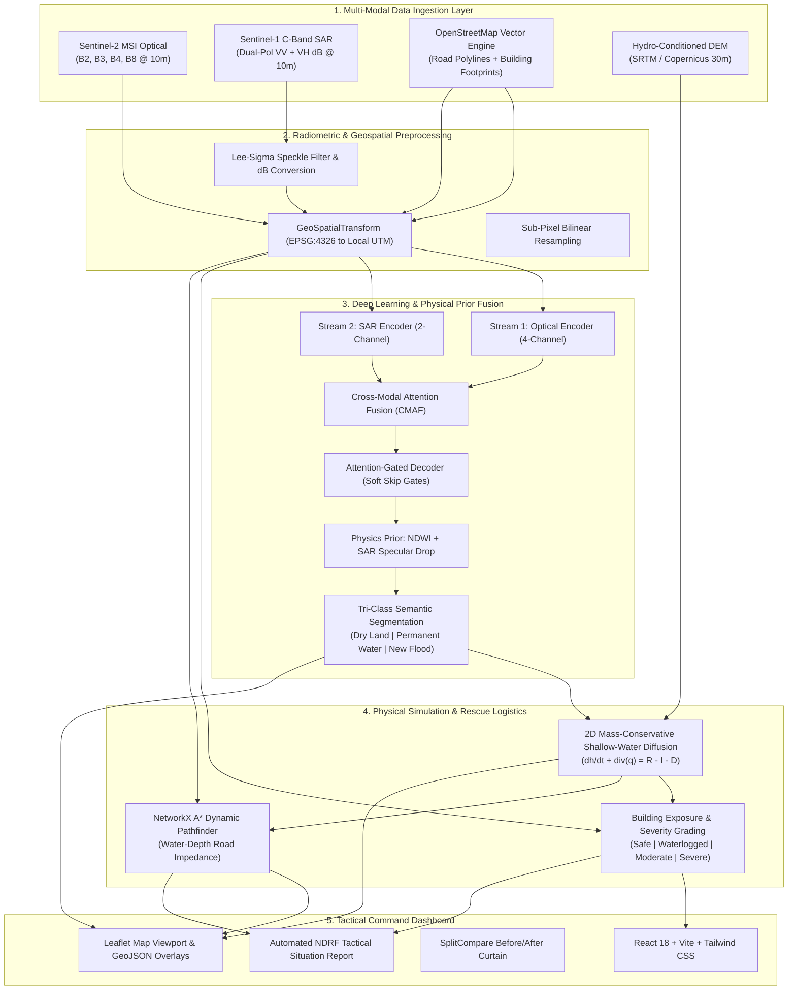

# FloodSense-AI: Complete System Architecture & Engineering Specification

**Project Title:** FloodSense-AI: Multi-Modal Flood Detection, Dynamic Flood Simulation, Infrastructure Damage Mapping and Emergency Rescue Routing System  
**Academic Level:** Bachelor of Engineering (B.E.) Computer Science & Engineering Final Year Capstone Project  
**Repository Working Directory:** `c:\Users\vicky\Desktop\Disaster Response`  
**Git Checkpoint Reference:** `7ef22b6`  

---

## 1. High-Level Architectural Overview

FloodSense-AI is a decoupled full-stack geospatial deep learning and emergency routing platform. It bridges high-resolution satellite remote sensing (European Space Agency Sentinel-1 C-SAR and Sentinel-2 MSI), physical fluid mechanics, and OpenStreetMap vector graphs to deliver sub-second disaster intelligence during catastrophic inundation events.

---

## 2. Component Subsystems

### 2.1 Backend Engine (`backend/app/`)
- **FastAPI Application Framework (`main.py`):** High-performance asynchronous REST API supporting asynchronous task scheduling, CORS headers, streaming responses, and multi-format payload serialization.
- **Deep Learning Core (`models/attention_unet.py`):** PyTorch implementation of `DualStreamAttentionUNet` featuring dual Siamese 4-stage encoders, Squeeze-and-Excitation (SE) channel calibration, multi-scale Cross-Modal Attention Fusion (CMAF), bottleneck bridge, and decoder spatial attention gates.
- **Geospatial Reference Service (`services/georef.py`):** Rigorous affine transform engine converting between WGS84 geographic coordinates (`EPSG:4326`), local Universal Transverse Mercator (UTM) metric projections (`EPSG:326XX`/`327XX`), and matrix indices with sub-pixel precision.
- **Physical 2D Flood Simulator (`services/simulation_engine.py`):** 2D time-stepped raster solver enforcing the hydrodynamic continuity and diffusive momentum equations ($\frac{\partial h}{\partial t} + \nabla \cdot q = R - I - D$). Features zero-mass-leakage flux limiters ($0.00\%$ mass balance error) and background job execution.
- **OpenStreetMap Service (`services/osm_service.py`):** Dual-tier vector acquisition querying live Overpass and direct OSM API 0.6 endpoints with local GeoJSON disk caching.
- **Emergency Router (`services/rescue_router.py`):** Dynamic NetworkX graph solver applying A* heuristic routing with depth-dependent penalty multipliers across 4 road hazard tiers (`OPEN`, `CAUTION`, `HIGH_RISK`, `BLOCKED`).
- **Tactical SitRep Generator (`services/sitrep_generator.py`):** NDRF / SDMA operational flash bulletin synthesis supporting Google Gemini 2.5 Flash and deterministic rule-based expert systems with Markdown and GeoJSON exports.

### 2.2 Frontend Client (`frontend/src/`)
- **Interactive Geospatial Viewport (`MapViewport.jsx`):** Leaflet map renderer with multi-spectral satellite basemaps, dynamic GeoJSON overlays, building severity markers, road blockage styling, and evacuation route paths.
- **Before/After Split Curtain (`SplitCompareSlider.jsx`):** Interactive comparison slider revealing pre-event optical imagery and post-event SAR backscatter drop with synchronized panning and zooming.
- **Dynamic Hydrological Forecaster (`TimelineSimulatorPanel.jsx`):** Time-step timeline scrubber (T+0h to T+48h) displaying mass-balance status, scenario presets, rainfall intensity sliders, and depth distribution histograms.
- **Empirical Model Benchmark Suite (`ModelBenchmarkTab.jsx`):** Real-time comparative telemetry displaying measured IoU, F1-Score, Precision, Recall, and confusion matrices against baseline Otsu and standard U-Net models.
- **Tactical Situation Report Modal (`SitRepModal.jsx`):** Official emergency briefing viewer with downloadable Markdown bulletins and printable PDF layouts.
- **Project Defense Walkthrough (`ProjectWalkthroughModal.jsx`):** 7-stage interactive viva presentation guide explaining every architectural design decision.

---

## 3. Data Pipeline & Information Flow

1. **Scene Selection:** User selects an AOI preset or submits custom satellite coordinates.
2. **Tensor Acquisition:** Pre-event 4-channel optical tensor $[4, 256, 256]$ and post-event 2-channel SAR tensor $[2, 256, 256]$ are loaded or fetched.
3. **Radiometric Calibration:** SAR backscatter is filtered for speckle using a Lee-Sigma kernel and converted to decibels ($\text{dB} = 10 \log_{10}(\gamma)$). Optical bands are min-max normalized.
4. **PyTorch Inference:** Tensors pass through `DualStreamAttentionUNet` to generate raw logits and explainable AI (XAI) attention maps.
5. **Physical Prior Blending:** Softmax probabilities are combined with NDWI and SAR specular drop thresholds to construct the tri-class ground mask.
6. **Vector Intersect:** Real OSM road segments and building polygons are clipped and intersected against the flood depth grid.
7. **2D Simulation:** Dynamic flood expansion is modeled over 48 hours under selected rainfall regimes.
8. **Evacuation Routing:** NetworkX computes shortest safe corridors from emergency response staging bases to isolated structures.
9. **SitRep Dispatch:** Metrics are compiled into military-grade emergency bulletins and broadcast to the dashboard.
