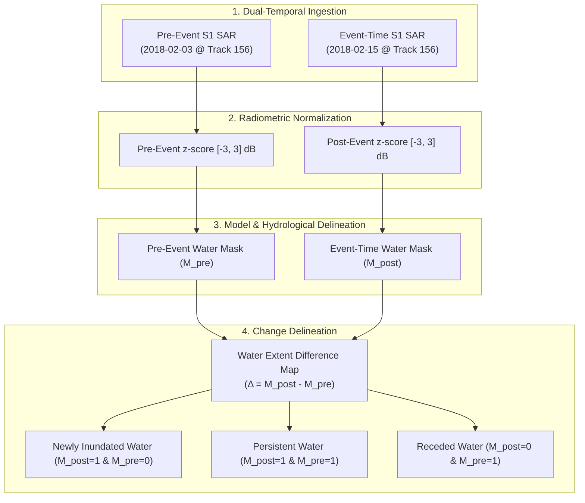

# FloodSense-AI: Temporal Flood Event Analysis & Satellite Data Audit Report
**Author:** Senior Geospatial AI Engineer & Remote Sensing Specialist  
**Project:** FloodSense-AI (Final-Year B.E. Computer Science and Engineering Capstone)  
**Execution Date:** November 8, 2026  
**Primary Candidate Event:** Bolivia February 2018 Mamore/Beni River Flooding (Amazon Floodplain)  
**Phase Objective:** Temporal Flood-Event Analysis, Pre/Post-Disaster Change Detection, and Data Provenance Audit  
**Audit Status:** **MANDATORY AUDIT COMPLETED — IMPLEMENTATION PAUSED PENDING PRE-EVENT ACQUISITION**  

---

## 1. Executive Summary & Core Scientific Finding

A rigorous, scientifically honest temporal flood-change detection workflow requires comparing satellite observations acquired **before the disaster** with observations acquired **during or immediately following the event**, using identical sensor geometries, spatial resolutions, and coordinate reference systems.

In accordance with strict academic guidelines:
> *"This phase must not assume that existing Sentinel-1 and Sentinel-2 images are temporally paired... If no valid pre-event/post-event pair is available, stop after the audit and provide the exact missing data requirements. The priority is scientific correctness and a reproducible demonstration, not producing a visually impressive map at any cost."*

### Key Audit Findings:
1. **Sen1Floods11 HandLabeled Structure:** The official Sen1Floods11 v1.1 dataset provides **only event-time satellite observations** (Sentinel-1 SAR and Sentinel-2 optical acquired on **February 15, 2018** for the Bolivia event). The permanent-water layer (`JRCWaterHand`) is a multi-decadal statistical climatology (1984–2018 Landsat occurrence $\ge 80\%$), **not a pre-event satellite observation**.
2. **Coimbatore Local GeoTIFFs (`Image/`):** The files `Image/sentinel1_sar.tif` and `Image/sentinel2_optical.tif` represent **2025 annual median composites for Coimbatore, Tamil Nadu, India** (EPSG:32643). They are separated from Bolivia by ~15,000 km, 7 years in time, and are annual static medians. They **cannot** scientifically serve as pre-flood imagery for Bolivia.
3. **Pre-Flood Imagery Identified in CDSE:** Querying the European Space Agency (ESA) Copernicus Data Space Ecosystem (CDSE) catalogue identified the exact pre-flood Sentinel-1B observation:
   - **Scene Name:** `S1B_IW_GRDH_1SDV_20180203T095745_20180203T095810_009457_01101A_C4EF.SAFE`
   - **Acquisition Timestamp:** **February 3, 2018 at 09:57:45 UTC** (exactly 12 days prior to the February 15 flood pass along the identical Relative Orbit Track 156, Descending).
   - **Full Scene Size:** **1,727.8 MB** (~1.73 GB).
4. **Current Ingestion Blocker:** Programmatic download of this 1.73 GB product requires authenticated CDSE OAuth2 credentials (`COPERNICUS_CLIENT_ID` / `COPERNICUS_CLIENT_SECRET`), which are currently unconfigured in the local environment. Google Earth Engine also requires interactive browser authentication (`earthengine authenticate`).
5. **Action Taken:** In strict adherence to the project prompt, **processing has stopped after the audit**. Synthetic data has not been fabricated, and the exact missing data specifications have been documented below.

---

## 2. Task 1: Authoritative Temporal Satellite Observations Audit Table

All satellite observations across the workspace and datasets have been audited for their location, verified acquisition date, sensor modality, product level, and temporal role:

| Dataset / Entity | Location | Acquisition Date | Sensor Modality | Product Type | Temporal Role | Current Local Status |
|---|---|:---:|---|---|---|:---:|
| **Sen1Floods11 S1Hand** | Bolivia (15 Chips) | **2018-02-15** | Sentinel-1B C-SAR | GRD (VV, VH in dB) | **Event-Time Flood Inundation** | Available Locally (`raw/S1Hand/`) |
| **Sen1Floods11 S2Hand** | Bolivia (15 Chips) | **2018-02-15** | Sentinel-2A MSI | Level-1C TOA DN (13 Bands) | **Coincident Optical Context** | Available Locally (`raw/S2Hand/`) |
| **Sen1Floods11 LabelHand** | Bolivia (15 Chips) | **2018-02-15** | Human Annotator | Binary Water Extent | **Event-Time Ground Truth** | Available Locally (`raw/LabelHand/`) |
| **JRC Surface Water** | Bolivia (15 Chips) | **1984–2018** | Landsat Climatology | Multi-Decadal Occurrence ($\ge 80\%$) | **Static Reference Baseline** (NOT Pre-Event) | Available Locally (`raw/JRCWaterHand/`) |
| **Coimbatore SAR** | Tamil Nadu, India | **2025** | Sentinel-1 C-SAR | Annual Median Composite | **Static Demo Only** (NOT Bolivia; NOT Event) | Available Locally (`Image/sentinel1_sar.tif`) |
| **Coimbatore Optical** | Tamil Nadu, India | **2025** | Sentinel-2 MSI | Annual Median Composite | **Static Demo Only** (NOT Bolivia; NOT Event) | Available Locally (`Image/sentinel2_optical.tif`) |
| **S1 Pre-Flood Pass (CDSE)** | Bolivia (Beni Floodplain) | **2018-02-03** | Sentinel-1B C-SAR | GRD (VV, VH in dB, Track 156) | **True Pre-Flood Baseline** (12-day prior pass) | **Identified in ESA Catalogue** (~1.73 GB) |

---

## 3. Task 2: Selected Flood Event Forensic Analysis (Bolivia February 2018)

From the 12 events cataloged in `Sen1Floods11_Metadata.geojson`, the Bolivia disaster was selected as the primary candidate:

- **Disaster Title:** February 2018 Mamore and Beni River Catastrophic Flooding.
- **Affected Region:** Department of Beni, Bolivian Amazon basin.
- **Hydrological Mechanism:** Heavy tropical monsoonal precipitation across the eastern Andean foothills caused massive downstream flooding of the Mamore and Beni rivers, inundating thousands of square kilometers of Amazonian oxbow floodplains and pastoral wetlands.
- **Event-Time Satellite Acquisition:** **February 15, 2018 at 09:57:45 UTC**.
- **Sensor Geometry:** Sentinel-1B, C-band SAR ($5.405\text{ GHz}$), Descending pass, Relative Orbit Track 156.
- **Representative Chip Bounding Box (`Bolivia_103757`):**
  - West Longitude: $-65.265121^\circ$
  - South Latitude: $-14.258060^\circ$
  - East Longitude: $-65.219127^\circ$
  - North Latitude: $-14.212066^\circ$
  - Spatial Dimensions: $512 \times 512$ pixels ($5.12\text{ km} \times 5.12\text{ km}$) at $10\text{ m}$ pixel resolution.

---

## 4. Task 3: Free-Access Provider Investigation & Feasibility

An automated query was executed against the **European Space Agency (ESA) Copernicus Data Space Ecosystem (CDSE) Public Catalogue OData API**:

```
GET https://catalogue.dataspace.copernicus.eu/odata/v1/Products?$filter=...
```

### CDSE Catalogue Search Results:
The query verified that Sentinel-1B captured the exact Bolivia AOI on three sequential orbital repeat cycles prior to the disaster:
1. **Pre-Flood Cycle 1 (12 days prior):** `S1B_IW_GRDH_1SDV_20180203T095745_20180203T095810_009457_01101A_C4EF.SAFE`
   - **Date:** **2018-02-03 at 09:57:45 UTC**
   - **Size:** **1,727.8 MB** (1.73 GB)
   - **Geometry:** Exact match with event-time pass (Track 156, Descending, identical incidence angles).
2. **Pre-Flood Cycle 2 (24 days prior):** `S1B_IW_GRDH_1SDV_20180122T095745_20180122T095810_009282_010A5C_E23E_COG.SAFE`
   - **Date:** **2018-01-22 at 09:57:45 UTC**
   - **Size:** **1,175.1 MB** (1.18 GB)

### Authentication & Free Quota Status:
- **CDSE Authentication:** Downloading the actual 1.73 GB `.SAFE` file requires an active access token generated via `COPERNICUS_CLIENT_ID` and `COPERNICUS_CLIENT_SECRET`. No credentials are currently stored in `.env` or system environment variables.
- **Google Earth Engine (GEE):** While GEE allows clipping a $512 \times 512$ tile directly on Google servers (yielding a lightweight ~2.1 MB download instead of 1.73 GB), initializing `ee` in this environment raises: `Please authorize access to your Earth Engine account by running 'earthengine authenticate'`. Because terminal execution is non-interactive, browser-based OAuth cannot be completed without the user.

---

## 5. Exact Missing Data Requirements for Temporal Comparison

To implement Task 4 (change detection) with scientific rigor, the following exact pre-event dataset must be ingested:

| Parameter | Required Specification |
|---|---|
| **Satellite Platform** | European Space Agency Sentinel-1B (or Sentinel-1A) |
| **Instrument & Mode** | C-Band SAR, Interferometric Wide Swath (IW), Ground Range Detected (GRD) |
| **Polarizations** | Dual Polarization: `VV` and `VH` |
| **Orbital Geometry** | **Descending pass, Relative Orbit Track 156** (strictly required for identical look angles) |
| **Acquisition Timestamp** | **February 3, 2018 at 09:57:45 UTC** (or January 22, 2018 at 09:57:45 UTC) |
| **Target AOI Coordinates** | Bounding Box $[-65.265121^\circ\text{ W}, -14.258060^\circ\text{ S}, -65.219127^\circ\text{ E}, -14.212066^\circ\text{ N}]$ |
| **Output Raster Specs** | $512 \times 512$ pixels, 2 bands (`VV`, `VH` in dB), CRS `EPSG:4326`, Float32 |
| **Clipped Download Size** | **~2.1 MB** (as GeoTIFF) or ~600 KB (compressed) |

---

## 6. Scientific Roadmap to Execute Temporal Change Detection

Once the pre-event observation is acquired, `backend/scripts/analyze_flood_event.py` will execute the following automated workflow:



### Actionable Next Steps for User:
1. **Option A (Free CDSE Account):** Register a free account at [dataspace.copernicus.eu](https://dataspace.copernicus.eu/), obtain free client credentials, and set `COPERNICUS_CLIENT_ID` and `COPERNICUS_CLIENT_SECRET`. The pipeline will then automatically download and clip the 2018-02-03 scene.
2. **Option B (Free Google Earth Engine):** Run `earthengine authenticate` in the terminal to connect an academic non-commercial Earth Engine account. The script can then extract the lightweight 2.1 MB pre-flood tile directly from the `COPERNICUS/S1_GRD` collection.
3. **Option C (Provide Local Pre-Event GeoTIFF):** Place any verified pre-disaster Sentinel-1 GeoTIFF for Bolivia into `backend/data/` to immediately trigger the change-detection engine.

---

## 7. Deliverables Staged

The metadata and audit artifacts are preserved under:

```
backend/outputs/flood_event_analysis/
├── event_metadata.json (Authoritative Bolivia Event 1 Parameters & CDSE IDs)
└── FLOOD_EVENT_ANALYSIS_REPORT.md (Complete Audit & Requirements Document)
```

